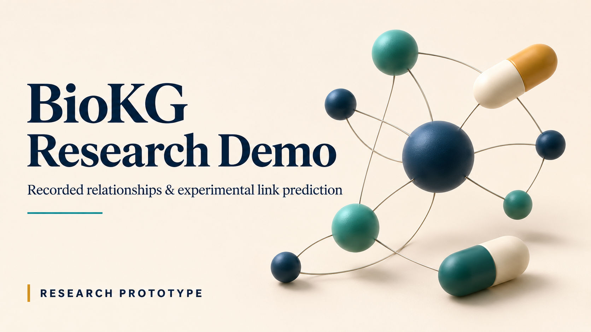

# BioKG Research Demo



*Conceptual cover illustration, not a visualization of actual BioKG records or model results.*

A Flask research prototype for exploring **recorded biomedical relationships** and experimental **relation-aware link prediction** using OGB BioKG.

This is not a clinical decision tool. Source relationships and model scores do not establish drug safety, clinical harm or treatment recommendations.

## Current functionality

- Explore recorded training-split relationships incident to two selected drugs.
- Display up to 100 edges, with typed entity identifiers and recorded relation IDs.
- Filter the returned neighborhood by entity type and inspect node identifiers.
- See an explicit message when the returned neighborhood is truncated.
- Run single and CSV batch scoring only when compatible, evaluated v2 model weights are available and predictions are explicitly enabled.
- Return scores as `uncalibrated_model_score`, without clinical likelihood thresholds.
- Report graph readiness separately from prediction availability at `/healthz`.

Predictions default to **unavailable**. The graph explorer can run without a model checkpoint, but still requires the official BioKG dataset.

The legacy `/explain`, `/explain_graph` and `/explain_view` endpoints return HTTP 503. Random explanation weights, hard-coded SHAP values and untrained GraphSAGE inference have been disabled. Validated model attribution is not implemented.

## Data and identifiers

The application uses the official **OGB `ogbl-biokg`** dataset. It constructs the source graph and model message-passing graph from the **official training split only**. Validation and test edges are not added to that graph, and synthetic reverse edges are not displayed as recorded relationships.

Inputs are **local BioKG drug indices**, not DrugBank identifiers or PubChem CIDs. Available drug-drug relation IDs come from `/relations` and are shown in the homepage dropdown.

The graph view returns incident relationships for either selected drug. It does not imply that the two drugs share a direct edge or cause an adverse interaction.

Optional DrugBank metadata requires files you are authorized to use. Missing enrichment files do not need to be replaced with fabricated data.

## Application usage

### Recorded relationships

1. Enter two distinct local drug indices on the homepage.
2. Choose **View recorded relationships**. No prediction checkpoint or relation selection is required for this action.
3. Filter entity types, drag nodes and select an entity to inspect its recorded identifier.

Indices `58` and `89` can be used as example inputs for the official dataset. They are not a validated clinical example.

### Single prediction

After a compatible checkpoint has been trained, fully evaluated and deliberately enabled:

1. Enter two distinct local drug indices.
2. Select a supported drug-drug relation ID.
3. Choose **Predict**.

The result is an **uncalibrated model score**, not a clinical probability. No harm or safety threshold has been established.

### Batch prediction

Upload a UTF-8 CSV with these headers:

```csv
drug1_id,drug2_id,relation_type
58,89,2
```

The upload field is `csv_file`. The output includes `uncalibrated_model_score` and `error`. Invalid rows receive an error and no score. The page provides a result download when scoring succeeds and an error message when the request fails.

Corrected prediction history uses `predictions_v2_log.csv`, keeping it separate from legacy score logs. Render's ephemeral filesystem does not provide durable log storage across deployments.

## Model and checkpoint compatibility

The corrected modeling path uses:

- A deterministic saved entity-type order and disjoint type offsets.
- R-GCN message passing over the training graph.
- A learned DistMult decoder that incorporates the selected relation.
- Real optimization with a loss, backpropagation and parameter updates.
- Typed head/tail corruption that excludes known training positives.

DistMult is symmetric for same-type entity pairs and has limitations for directional relationships. Unrecorded training negatives can also contain unknown true relationships.

The old training script performed a forward pass and saved weights without optimization. The legacy downloadable checkpoint contains only `model_state_dict`, a two-dimensional encoder output and no relation decoder or training/evaluation metadata. Its training provenance cannot be established from that artifact, and it is incompatible with the corrected architecture.

V2 checkpoints record the architecture, node counts, relation order, offsets, training-graph hash, optimizer steps, seed and evaluation reports. Loading checks this contract and uses strict parameter loading. Legacy or incompatible weights are not silently reused.

## Evaluation and current limitations

Evaluation ranks the official provided typed negative candidates on both head and tail sides, using mean reciprocal rank (MRR) with OGB tie handling. Reports include drug-drug relation breakdowns.

Serving requires complete official validation and test reports. A partial run marked `complete: false` cannot enable predictions. Completing this gate checks artifact compatibility and evaluation completeness; it does not establish acceptable model quality or clinical usefulness.

Verification performed during the refresh included:

- 39 Python regression tests covering startup, transfers, indexing, scoring, optimization, checkpoint rejection and routes.
- DOM/D3 checks for rendering, filtering, truncation and entity inspection.
- Startup and graph checks using actual official BioKG data.
- One actual optimization step and execution checks on 16 validation rows and 16 test rows.

Those small evaluation subsets establish execution only. They are not estimates of DDI prediction quality. Full model training, complete held-out evaluation, calibration and validated explanations remain outstanding.

## Setup

Use Python 3.11 or 3.12. For a CPU host:

```bash
pip install torch --index-url https://download.pytorch.org/whl/cpu
pip install -r requirements.txt
python prepare_runtime.py
python run.py
```

Open `http://localhost:8080`.

Initial preparation downloads the official BioKG archive and prepares `dataset/ogbl_biokg`. This requires access to the official Stanford download host and several GB of disk space. Model-enabled processes also require memory for the encoder and cached embeddings.

Only the trusted OGB cache/splits use pickle-compatible loading. Model checkpoints use `weights_only=True`; the loader does not globally override `torch.load`.

## Training

Training is separate from web startup.

```bash
# Execution smoke test only; this checkpoint cannot enable serving.
python -m src.train.train_rgcn --steps 1 --batch-size 32 \
  --hidden-channels 8 --max-eval 16 --output models/smoke_v2.pt

# Example starting configuration; choose the training budget using validation.
python -m src.train.train_rgcn --steps 100 --batch-size 1024 \
  --output models/rgcn_candidate.pt

# After fixing the recipe using validation, evaluate the official test split.
# Omit --max-eval to produce complete validation and test reports.
python -m src.train.train_rgcn --steps 100 --batch-size 1024 \
  --evaluate-test --output models/rgcn_v2.pt
```

The example 100-step configuration is not a validated training budget. Full-graph R-GCN training can require substantial memory. Inspect overall and per-relation results before deciding whether the model is useful for the intended research task.

After training and reviewing complete evaluation, supply `models/rgcn_v2.pt`, or set `MODEL_URL` to a trusted compatible v2 checkpoint. Explicitly set `ENABLE_PREDICTIONS=true` to enable scoring. Do not use the legacy checkpoint URL.

## Deployment on Render

Create or locate a **Web Service** connected to this repository. Use the repository root and the reviewed deployment branch.

| Setting | Value |
| --- | --- |
| Build command | `pip install torch --index-url https://download.pytorch.org/whl/cpu && pip install -r requirements.txt && python prepare_runtime.py` |
| Start command | `gunicorn run:app --bind 0.0.0.0:$PORT --workers 1 --timeout 600` |
| Health check | `/healthz` |
| Initial environment | `FLASK_ENV=production`, `ENABLE_PREDICTIONS=false`, a private `FLASK_SECRET_KEY` |

For a Blueprint, synchronize `render.yaml`. Existing manually configured services require their dashboard commands and environment to be updated directly. The existing Fly.io workflow does not deploy the Render service.

A provider response containing `x-render-routing: no-server` requires checking the exact service hostname, workspace, service existence/status and deployment logs. Changing Flask routes or billing details alone does not establish that a serving instance exists.

After deployment, verify the homepage, graph generation and health response. With predictions disabled, a valid prediction request should return HTTP 503 without a score. Do not present the demo as live until the actual public deployment has been checked.

## Endpoint behavior

| Endpoint | Behavior |
| --- | --- |
| `GET /` | Research form and prediction-availability notice |
| `GET /relations` | Supported drug-drug relation IDs |
| `GET /graph?drug1_id=58&drug2_id=89` | Recorded relationship viewer |
| `GET /graph_data?drug1_id=58&drug2_id=89` | Bounded recorded neighborhood; invalid inputs return 400 |
| `POST /predict` | Corrected score, 400 for invalid input, or 503 when unavailable |
| `GET /batch` | CSV upload page |
| `POST /batch` | Result CSV or an input/availability error |
| `GET /healthz` | Graph readiness and separate prediction/explanation availability |
| `GET /download_log` | V2 prediction history, or 404 if no V2 log exists |
| `GET /explain`, `/explain_graph`, `/explain_view` | 503; validated explanations unavailable |

## Tests

```bash
python -m unittest discover -s tests -v
npm install --prefix /tmp/ddi-dom --no-package-lock jsdom@31.0.1 d3@7.9.2
NODE_PATH=/tmp/ddi-dom/node_modules node tests/test_graph_dom.cjs
```

The DOM checks use Node 24+. Test fixtures are synthetic and are never served as replacement biomedical data. Passing tests does not establish prediction accuracy or a successful production deployment.

## Images and article series

The cover is conceptual artwork. Earlier screenshots in `public/` show the historical interface and may contain obsolete probability or explanation labels. Do not use them to describe the current application.

After deployment, capture new screenshots of:

- The homepage with its actual prediction-availability state.
- The recorded relationship view using actual BioKG data.
- The batch page, showing either its unavailable notice or actual results.

The six-part article series is a tutorial and proposed research progression. The repository is a separate implementation. Validated explainers, genomic/temporal extensions and broader tutorial integrations must not be presented as implemented here. Article 1 remains unchanged; revisions to Articles 2–6 are separate writing deliverables.

## Sources

- [Official OGB BioKG dataset and evaluation protocol](https://ogb.stanford.edu/docs/linkprop/#ogbl-biokg)
- [OGB BioKG reference implementations](https://github.com/snap-stanford/ogb/tree/master/examples/linkproppred/biokg)
- [PyTorch Geometric heterogeneous graph data](https://pytorch-geometric.readthedocs.io/en/stable/generated/torch_geometric.data.HeteroData.html)

## License

[MIT](LICENSE). BioKG source datasets and optional third-party enrichment retain their own licenses and usage requirements.
